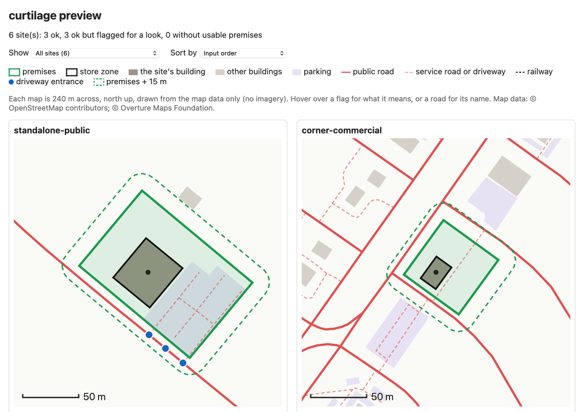

# curtilage

*Curtilage: the land immediately around a building, such as its yard, drive and lot.*

Generates a site's **premises polygon** (the building plus its customer-facing lot) and a **store zone** (the building's own outline) from free map data, so nobody has to draw them by hand.

**Status:** 0.3, rule-based; the API may change before 1.0. How it's been checked so far, on private sets of real sites that can't be published:

- On 164 sites the rules had never seen, 159 (97%) got a polygon that passed the gem's own validation (pin inside, closed, no self-intersection, plausible size). Nearly all five misses were buildings missing from OpenStreetMap. Passing validation means usable, not necessarily right.
- Against hand-drawn premises for those sites, the median overlap (IoU) was 0.47. Hand-drawn polygons often hug the building more tightly than the whole lot this gem aims for, so IoU undersells generous but correct results.
- The 20 sites used to tune the rules were also reviewed by eye on aerial imagery, which is a subjective check. An earlier version gave similar validity on 51 sites in the US, Brazil and Hungary (47 of 51).

## Quick start

1. Install the gem (`gem install curtilage`, or `gem "curtilage"` in your Gemfile; Ruby 3.2 or newer) and the [DuckDB CLI](https://duckdb.org/docs/installation/), 1.4 LTS or 2.0 (`brew install duckdb` gives 2.0). Check with `curtilage doctor`; DuckDB's extensions install themselves.
2. Ask for premises:

```ruby
require "curtilage"

result = Curtilage.premises([-80.0, 35.0])   # [lng, lat]
result.ok?          # true when it passed validation
result.ring         # the premises polygon, [[lng, lat], ...]
result.store_ring   # the building's outline, inside the premises
result.flags        # anything a person should check, e.g. [:near_houses]
result.to_geojson   # ready to draw or save, with the attribution to show
```

Or from the shell:

```sh
curtilage generate --pin -80.0,35.0                     # one pin: GeoJSON to the screen
curtilage generate --in sites.csv --out premises.csv    # a file of pins in; CSV, GeoJSON or KML out
curtilage preview --in sites.csv                        # a page with a map of each site, to check by eye
```

`sites.csv` needs `lng` and `lat` columns; an `id` column is carried through to the output:

```csv
id,lng,lat
store-1,-80.0,35.0
store-2,-80.1,35.2
```

That's all the setup: map data is fetched as needed. No Ruby? Use [Docker](#docker). Everything else (every option, flag and command) is in the [reference](docs/reference.md).

## Data licence

The code is MIT-licensed; the polygons are not. Every result is derived from [OpenStreetMap](https://www.openstreetmap.org/copyright) data, which is available under the [Open Database License (ODbL) 1.0](https://opendatacommons.org/licenses/odbl/1-0/):

- **Credit OpenStreetMap wherever results are shown or shared**, and make clear the data is under the ODbL ([OSMF attribution guidelines](https://osmfoundation.org/wiki/Licence/Attribution_Guidelines)). Every output carries what to credit: `attribution` in GeoJSON properties and in CSV, the KML description, the preview page.
- **Storing or publishing many results** can make a *derivative database*. If you use one publicly, the ODbL asks you to offer it under the ODbL too (section 4.4).
- **A map image or similar *produced work*** made from results needs a notice that it contains data from OpenStreetMap under the ODbL (section 4.3); the image itself doesn't have to be ODbL.
- Overture data is also credited to the Overture Maps Foundation, and Overture's non-OSM buildings to their source, when a result could use them. Microsoft's footprints are under [CDLA Permissive 2.0](https://cdla.dev/permissive-2-0/).
- The OSMF [community guidelines](https://osmfoundation.org/wiki/Licence/Community_Guidelines) cover the common cases (produced works, what counts as substantial, collective databases, geocoding). This section is a summary, not legal advice.

## How it works

1. **Data.** Buildings, parking lots, roads and railways from OpenStreetMap, picked automatically (`source: :auto`, the default):
   - **Scattered pins: Overture Maps, read in place.** The same OpenStreetMap data from Overture's public release, read straight from their storage: about 5-10 s per area, nothing downloaded.
   - **Many pins in one region, or a region already cached: a Geofabrik build.** The gem downloads only the layers it needs from that region's shapefiles and builds a compact Parquet file, 1-5 minutes per US state, then answers instantly.
   - Or force one: `source: :geofabrik` (the host only ever learns the region, never the area) or `source: :overture`. Or use your own prebuilt files (`curtilage build`), local or in a bucket.
2. **Generate.** Start from the building at the pin and grow its rectangle 30 m toward its lot, then:
   - stop at public roads, half a typical road width short of the centreline (by road class) but at least 3 m out from the building, following each road's direction; and at railways;
   - take in the site's mapped parking (a lot shared with a few buildings is claimed whole; a shopping-centre lot is split by nearest building), parking garages, canopies, and driveways to the street;
   - stop 3 m short of neighbouring buildings, or halfway when the site is behind a house (its back yard);
   - fall back to the building's rectangle plus a margin if that fails validation.
   Every result explains each step and carries review flags.
3. **Validate.** Reject or flag polygons that are unsafe to use: pin outside, unclosed, self-intersecting, swapped coordinates, too far from the pin, an implausible size. The store zone always sits inside the premises.

It's rule-based: no machine learning in the method. Coordinates are `[lng, lat]` throughout, as in GeoJSON.

## Usage

### In Ruby

```ruby
pins = [[-80.0, 35.0], [-80.1, 35.2]]
results = Curtilage.generate_many(pins)                       # data picked automatically (Overture or Geofabrik)
results = Curtilage.generate_many(pins, source: :geofabrik)   # always build regions: most private, slower
results = Curtilage.generate_many(pins, preset: :centre)      # whole shopping centre where on a shared lot

Curtilage.configure do |c|                                    # once, instead of options on every call
  c.cache_dir = "/var/cache/curtilage"                        # reuse on-demand builds for a month
end
```

- Styles: `preset: :whole_lot` (default), `:tight` (building plus a small margin) or `:centre`. `store_zone: false` skips the store zone. Every rule's distance is an option ([reference](docs/reference.md#generation-options)).
- Built ahead of time, for instant lookups: `curtilage build tennessee`, then `generate_many(pins, catalogue: Curtilage::Catalogue.from_dir("."))`. Files can also live in a bucket (`s3://`, `gs://`, `https://`).
- Just the building at a pin: `Curtilage.building_at(pin)`.
- Big sites (a big-box store's lot can pass 100,000 m2, where validation stops by default): raise the limits, e.g. `validation: { max_area_m2: 200_000, max_area_error_m2: 300_000 }` ([reference](docs/reference.md#validation-limits)).
- Check a polygon someone already drew: `Curtilage::Audit.check(pin, ring, features)` returns `:ok`, `:review` (with reasons) or `:invalid`.

### What each result holds

| | |
|---|---|
| `ok?` | It passed validation. Never save one that isn't. |
| `ring` / `store_ring` | The premises and the store zone, `[[lng, lat], ...]` closed. |
| `flags` | Reasons a person should look first ([below](#flags)). |
| `explanation` | Each step, in plain words. |
| `details` | The building (id, name, type, area, outline), mapped parking inside the premises and an estimate of spaces, street frontage, and where driveways meet the street. Rough, like the map data. |
| `buffered(15)` | The premises grown 15 m (rounded corners), e.g. for a geofence with a margin; negative shrinks. |
| `to_geojson`, `to_wkt` | Ready to draw or store. GeoJSON carries everything above and the attribution to show. |
| `attribution` | What to credit wherever the result is shown ([Data licence](#data-licence)). |

### Files

`curtilage generate --in FILE --out FILE` reads pins from a CSV (as above) or a GeoJSON file of points, and writes:

- **CSV** (`.csv`): one row per pin with its id, `ok`, flags, the details, the polygons as WKT and the attribution. Opens in any spreadsheet.
- **GeoJSON** (`.geojson`): one FeatureCollection, the premises and store zone of each pin, with the id in each feature's properties.
- **KML** (`.kml`): for Google Earth, with the attribution in its description.

From Ruby, `Curtilage::Formats` does the same ([reference](docs/reference.md#files-curtilageformats)).

### Checking results by eye

`curtilage preview --in sites.csv` writes `curtilage-preview.html`: a card per site with a map drawn from the map data the premises were made from. Each map shows:

- the premises (green), the store zone (outline) and the pin;
- the site's building (darker) and its neighbours, mapped parking, public roads (hover for the name), service roads and driveways, and railways;
- where driveways meet the street (blue dots), and with `--buffer 15` the premises grown 15 m (dashed);
- a 50 m scale bar; each map is 240 m across, north up.

Under each map: the flags (hover for what they mean), the building and premises areas, parking and an estimate of spaces, street frontage, the number of entrances, and "How it was made", the step-by-step explanation. Invalid results say why.

At the top, a count of sites that are ok, flagged or unusable, and controls to show only some (sites that need a look, invalid ones, or those with a given flag) and to sort them (input order, needs a look first, id, or premises size).



*Randomly chosen locations, not real sites. Map data © OpenStreetMap contributors.*

The page loads nothing from the internet (no map tiles, scripts or fonts), so opening it reveals no locations. It does contain the coordinates, so share it only as you would them. From Ruby: `Curtilage::Preview.html(Curtilage.generate_many(pins, keep_features: true))`.

### Docker

The repository's `Dockerfile` packages the gem with DuckDB and its extensions, for machines without Ruby:

```sh
docker build -t curtilage .
docker run --rm -v "$PWD:/work" -v curtilage-cache:/cache curtilage generate --in sites.csv --out premises.csv
```

The current folder is mounted at `/work`, so file names are relative to it. The `curtilage-cache` volume keeps on-demand builds for a month.

### Flags

| Flag | Meaning |
|---|---|
| `near_houses` | The lot borders a home: check where the yard or property line is |
| `large_building` | Building over 5,000 m2: may be shared by several tenants |
| `small_building` | Building under 50 m2: may be a kiosk or canopy rather than the store |
| `building_not_under_pin` | No building under the pin; the nearest one within 30 m was used |
| `store_may_be_unit` | Store zone is a building over 1,500 m2: the store may be one unit of it |
| `shopping_centre` | `scope: :centre` mapped the whole centre |
| `fallback` | The main method failed validation; the building rectangle was used |
| `partial_data` | Part of the area around the pin is in a region that isn't built |
| `ml_footprint` | Built on a machine-learned footprint, not an OSM building |
| `no_data` | No map data covers the pin |
| `error` | Generating this site raised an error (see its explanation); the rest of the batch went on |

### Speed

- Generate: about 100 ms per site (median; a few hundred ms in dense blocks).
- Prebuilt files: about 85 ms per lookup through the DuckDB CLI; one call serves many pins.
- Overture (the default for scattered pins): about 5-10 s per area; pins within a few km of each other share it. A test batch of 51 sites in 17 regions across three continents took 4 minutes from a cold start; the 164 (143 pins read from Geofabrik builds, 21 from Overture) took under 6.
- Geofabrik builds (the default once 10+ pins share a region): 1-5 minutes per US state the first time (Texas, the largest tested, about 4.5 minutes and under 650 MB of memory), then as above. Downloads use `curl` when it's installed, and `data: { parallel_builds: 2 }` builds two regions at once on machines with the memory.

## Known limitations

Rules on open map data go a long way, but some sites need a person. These are the patterns seen in testing, and what helps:

- **The building isn't in OpenStreetMap** (about 3-8% of sites tested). Nothing is generated. Opting in to machine-learned footprints (`buildings: :osm_filled`) usually fills the gap.
- **A store that's one unit of a long or large building** (storefronts in urban blocks, strip malls). The premises cover the whole building and its lot, often several times too big. Flagged `store_may_be_unit` or `large_building`; `preset: :tight` or `preset: :centre` may suit these better.
- **Sites spread over several buildings** (compounds, campuses). The premises cover the building at the pin only, so they come out too small.
- **Dense rowhouse blocks.** Cuts toward many close neighbours can leave a thin sliver.
- **`near_houses` is noisy in dense urban areas,** where almost every site borders homes. It's more meaningful in suburbs.
- **The polygon is always convex,** so entrance notches and L-shaped lots are approximated.
- **Sites within about 100 m of the antimeridian** (180° longitude: parts of Fiji, Chukotka, the Aleutians) get no polygon: premises can't cross that line, so validation refuses them.

## Building footprints: OSM, or OSM plus machine-learned

By default all buildings come from OpenStreetMap. Where OSM is missing buildings, you can opt in to [Microsoft's Global ML Building Footprints](https://github.com/microsoft/GlobalMLBuildingFootprints) (CDLA Permissive 2.0): build with `--ml-footprints microsoft` (or `ml_footprints: "microsoft"`), then generate with `buildings: :osm_filled` or `:ml`. With `source: :overture`, Overture's non-OSM buildings play the same role. Results built on one carry the `ml_footprint` flag, and their attribution credits the footprints' source.

## Privacy

Pins never leave the machine as coordinates: they aren't put in any URL or request, and appear only in your own outputs and local error messages. What hosts can learn depends on the data source:

| When | Host | What it learns |
|---|---|---|
| Geofabrik build (`source: :geofabrik`, or `:auto` where 10+ pins share a region or it's cached) | `download.geofabrik.de` | Which region(s) you build, from the region index and the region's file. Not where in the region. |
| Overture read (`source: :overture`, or `:auto` for scattered pins) | `stac.overturemaps.org` | Which Overture release you use. Nothing about the pins. |
| | Overture's storage (Amazon S3, `overturemaps-us-west-2`) | Which files and parts of files are read: roughly where each pin is, to within a few km. |
| Your own built files (`catalogue:`, `parquet:`) on disk | none | Nothing. |
| ... in your bucket (`s3://`, `gs://`, `https://`) | your bucket's host | The parts of files read: roughly where each pin is. |
| Microsoft footprints in a build (opt-in) | Microsoft's footprint host | Which tiles cover the region you build. |
| First run, or `curtilage doctor` | DuckDB's extension repository | That you install the `spatial` and `httpfs` extensions, and your DuckDB version and platform. |

- **For a sensitive list of locations, use `source: :geofabrik`** (or `CURTILAGE_SOURCE=geofabrik`): hosts then learn only which regions you build. `:auto` reads scattered pins from Overture.
- The gem's own downloads go only to Geofabrik, Overture's catalogue and Microsoft's footprint host, and anything else is refused. DuckDB reads Overture's storage, your bucket and its extension repository itself.
- If a DuckDB query fails, its error message can quote part of the query, including the coordinates of the box around a pin. That stays on your machine unless your app forwards errors to an outside service.
- To guarantee nothing leaves the machine, set `CURTILAGE_OFFLINE=1` and use prebuilt files or a cache: downloads, extension installs and Overture or bucket reads are then refused.
- The preview page loads nothing from the internet. Building the Docker image fetches DuckDB from its GitHub releases and its extensions from DuckDB's repository.

## Layout

| Path | What |
|---|---|
| `lib/curtilage.rb` | Entry points: `generate`, `generate_many`, presets |
| `lib/curtilage/generator.rb` | Methods, the fallback chain, road and neighbour trims, flags |
| `lib/curtilage/generator_lot.rb` | Which parking, garages, canopies and driveways are the site's |
| `lib/curtilage/generator_store.rb` | The store zone |
| `lib/curtilage/generator_details.rb` | Facts about the site: parking, frontage, entrances |
| `lib/curtilage/result.rb` | What generation returns: GeoJSON, WKT, buffering |
| `lib/curtilage/formats.rb` | Pins in from CSV or GeoJSON; results out as GeoJSON, CSV or KML |
| `lib/curtilage/preview.rb` | The HTML review page |
| `lib/curtilage/features.rb` | Parses nearby map features (untrusted) and projects them to metres |
| `lib/curtilage/geometry.rb` | Plain-Ruby planar geometry |
| `lib/curtilage/validation.rb` | Checks a polygon against its pin |
| `lib/curtilage/audit.rb` | Checks an existing polygon against the map and the generated one |
| `lib/curtilage/auto_data.rb` | Builds the regions pins need on demand, into a temporary or cache folder |
| `lib/curtilage/regions.rb` | Geofabrik's region index: which region a pin is in |
| `lib/curtilage/build.rb` | Builds a region's features Parquet file from Geofabrik shapefiles |
| `lib/curtilage/zip_range.rb` | Downloads only the needed files from a remote zip |
| `lib/curtilage/catalogue.rb` | Finds the built region file(s) covering a pin |
| `lib/curtilage/lookup.rb` | Reads the features around pins from Parquet files |
| `lib/curtilage/overture.rb` | Reads features in place from Overture Maps |
| `lib/curtilage/footprints.rb` | Optional machine-learned footprints (Microsoft) |
| `lib/curtilage/download.rb` | HTTPS downloads from allowed hosts, with size caps |
| `lib/curtilage/config.rb` | Shared settings (`Curtilage.configure`, environment variables) |
| `lib/curtilage/duckdb.rb` | Runs the DuckDB CLI |
| `lib/curtilage/error.rb` | `Curtilage::Error`, the base of every error the gem raises |
| `exe/curtilage` | `curtilage generate`, `preview`, `build` and `doctor` |
| `Dockerfile` | The gem with DuckDB, ready to run |
| `docs/reference.md` | Every option, setting, flag and command |
| `sql/build_from_shapefiles.sql` | DuckDB query: shapefiles to a features Parquet file |
| `test/` | Tests, using made-up coordinates only |
| `benchmark/` | The public benchmark: sites, hand-drawn references, the runner ([how to run it](benchmark/README.md)) |

## Development

```sh
bin/setup
bundle exec rake        # tests and RuboCop
bundle exec rake benchmark   # the public benchmark (see benchmark/README.md)
```

No Ruby gem dependencies. Getting data needs the [DuckDB](https://duckdb.org/) CLI (1.4 LTS or 2.0 are tested; `curtilage doctor` checks it and says how to install it); its `spatial` and `httpfs` extensions install themselves on first use. Point `CURTILAGE_DUCKDB` and `CURTILAGE_EXTENSIONS` at them if they aren't in the default places (`curtilage doctor` checks). Nothing else is needed: `curl` is used when it's installed, as a faster download path.

## Versioning

- The public API is what [docs/reference.md](docs/reference.md) documents: the Ruby methods and their options, result fields, flags, errors, and the command line with its exit status. Anything not listed there is internal and may change at any time.
- Until 1.0, a minor release (0.x) may change the public API. Every such change is listed under **Breaking** in [CHANGELOG.md](CHANGELOG.md), with how to update. Patch releases don't change it.
- Rule improvements can change the polygons a release produces; the changelog says when they do.

## This repository

- The code is MIT-licensed (see `LICENSE.txt`); results keep the map data's licence ([Data licence](#data-licence)).
- Downloaded files and built Parquet files are OSM-derived data. They're never committed to this repository (see `.gitignore`).
- This repository must never contain real site locations, private data or credentials. Tests and examples use made-up coordinates.
- Security issues: see `SECURITY.md` (report privately through GitHub); the threat model is in [docs/security.md](docs/security.md).
